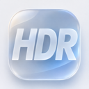

# HDR 开关 / HDR Toggle

Chrome 扩展：点击工具栏图标，全局切换「SDR 优先」和「原始 HDR 能力」。作用于普通 HTTP / HTTPS 网页及其嵌入播放器，不局限于 YouTube。已播放的视频需要刷新页面重新选流。

Chrome extension: click the toolbar icon to toggle SDR preference globally across HTTP/HTTPS pages. Reload playing pages to renegotiate streams. Compatibility depends on the player.

**仓库 / Repo:** https://github.com/ZhangJP-wh/chrome-hdr-toggle  
**版本 / Version:** 1.1.0

## 给电脑小白：一分钟安装 / 1-minute install

1. 点击 **Code → Download ZIP** 并解压。 / Download and unzip.
2. 打开 `chrome://extensions`，开启「开发者模式」。 / Enable Developer mode.
3. 点击「加载已解压的扩展程序」，选择包含 `manifest.json` 的文件夹。 / Load unpacked.
4. 固定扩展图标，点击一次开启 SDR 优先，再点恢复原始能力。 / Pin and click the icon to toggle.
5. 刷新需要切换的视频页面。 / Reload video pages.

无需编译、登录或命令行。需要 Chrome 119 或更新版本。 / No build, login or CLI. Chrome 119+.

## 使用 / Usage

| 图标标记 / Badge | 含义 / Meaning |
|---|---|
| AUTO | 默认状态，保留播放器原有 HDR 能力 / Original capabilities |
| SDR | 已开启全站 SDR 优先策略 / SDR preference enabled globally |
| ! | 设置发生错误，请重新加载扩展重试 / Settings error; reload extension |

开关对所有普通网页同时生效并记住设置，包括其他窗口。它会立即改变已打开网页后续的能力检测结果；已经缓冲的 HDR 视频不会自动变为 SDR，必须刷新重新选流。恢复 AUTO 同样需要刷新。标记表示策略状态，不代表检测到了当前视频的实际 HDR 状态。不自动刷新网页，以免打断播放或丢失未提交内容。

The toggle persists across sessions and applies across windows. Capability probes change immediately; buffered streams need a page reload. The badge indicates policy, not actual video HDR status. Pages are not automatically reloaded.

## 原理与限制 / How it works and limits

在网页启动时拦截 MediaSource.isTypeSupported、HTMLMediaElement.canPlayType 和 MediaCapabilities.decodingInfo，拒绝常见 HDR / 10 位格式，引导支持能力协商的播放器选择 SDR。

Intercepts media capability probes to reject common HDR/10-bit configurations and encourage SDR selection.

- **不能保证关闭任意播放窗口的 HDR。** 没有 Chrome 扩展 API 可直接控制所有视频的 HDR 输出；固定 HDR 文件、不做能力协商的播放器、DRM、WebCodecs 和特殊编码可能不响应。
- 不做色调映射、不修改系统 HDR 设置；AUTO 只恢复原始能力，是否播放 HDR 仍由视频、网站、浏览器和显示设备决定。
- 会同时排除部分 10 位 SDR 格式，最高分辨率、帧率可能降低；没有 SDR 替代流时也可能无法播放，切回 AUTO 并刷新即可恢复。
- Chrome 内置页面、扩展商店及受限制页面无法注入。网站权限被限制时只能在允许的网站生效。仅覆盖当前 Chrome 配置文件。

Not a universal HDR output switch or a tone mapper. Fixed HDR files, DRM, WebCodecs and players that bypass capability negotiation may be unaffected. Some 10-bit SDR streams are also excluded; resolution or frame rate can fall, or playback may fail without an SDR alternative. Restore AUTO and reload to recover. Restricted pages and other Chrome profiles are outside scope.

参考 / References: [Chrome scripting](https://developer.chrome.com/docs/extensions/reference/api/scripting), [Media Capabilities](https://www.w3.org/TR/media-capabilities/).

## 给 AI Agent / For AI Agents

按 [AGENT_INSTALL.md](AGENT_INSTALL.md) 安装并验证。

## 更新 / Updating

替换文件后，在 `chrome://extensions` 点击「重新加载」，检查网站访问权限，再刷新视频页面。旧版 YouTube SDR 建议移除以免重复拦截。GitHub 更新不会自动升级已安装副本。

Replace files, reload the extension, review site access and refresh video pages. Remove the old YouTube SDR extension to avoid duplicate interception. Installed copies do not auto-update from GitHub.

## 隐私 / Privacy

没有服务器、遥测、Cookie 读取或内容上传。只用本地存储保存开关。全站网站访问权限用于注入媒体能力检测脚本；临时枚举标签页以同步所有页面，不保存或发送网址。不含外部脚本或依赖。

No servers, telemetry, cookie access or uploads. Local storage contains only the toggle. Site access enables media capability interception; tab enumeration synchronizes open pages without saving or transmitting URLs.

## 验证 / Validation

提供模拟能力检测与开关测试。真实网站、DRM 和 HDR 显示器兼容性尚未全面验证，不承诺所有视频有效。

Includes simulated capability and toggle tests. Real-site, DRM and HDR-display compatibility is not comprehensively verified.

## 变更 / Changelog

### 1.1.0

采用用户提供的液态玻璃 HDR 图标；扩大为 HTTP/HTTPS 全站；改为点击图标全局切换，保存状态并同步已打开页面。默认 AUTO。

Liquid-glass HDR icons, global HTTP/HTTPS scope, one-click persistent toggle and live capability synchronization. Defaults to AUTO.

### 1.0.0

初始 YouTube SDR 版本。 / Initial YouTube SDR version.

## License

MIT。图标由项目所有者提供。 / MIT. Icon supplied by the project owner.
